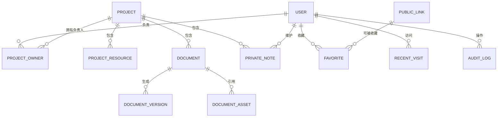

# Atlas 研发知识中心数据模型设计

## 1. 文档说明

本文档描述 Atlas 研发知识中心 MVP 阶段的数据模型设计。模型以支撑当前 PRD 和页面原型为目标，同时为后续权限系统、GitLab 集成、企微通知、管理层视图预留扩展能力。

本文不绑定具体数据库实现，但字段类型参考常见关系型数据库设计。实际落库时可根据 MySQL、PostgreSQL 或其他数据库进行类型调整。

## 2. 设计原则

- 以项目为核心聚合资源入口、文档、负责人、私有笔记和变更记录。
- 项目、资源入口、文档、工具导航均采用软删除。
- 所有关键业务表保留创建人、更新人、创建时间、更新时间。
- 文档每次保存生成版本记录。
- 收藏、最近访问、私有笔记按用户隔离。
- 第一版不实现复杂权限，但预留权限相关字段。
- 操作审计独立存储，不依赖业务表当前状态。

## 3. 核心实体关系

## 4. 通用字段约定

### 4.1 主键

建议使用雪花 ID、UUID 或数据库自增 ID。本文统一使用 `id` 表示主键。

### 4.2 时间字段

- `created_at`：创建时间
- `updated_at`：更新时间
- `deleted_at`：删除时间，空值表示未删除

### 4.3 用户字段

- `created_by`：创建人 ID
- `updated_by`：更新人 ID
- `deleted_by`：删除人 ID

### 4.4 软删除

业务查询默认过滤 `deleted_at is null`。

被删除数据进入回收站，可由有权限用户恢复。恢复时清空 `deleted_at` 和 `deleted_by`，并写入操作审计。

### 4.5 排序字段

列表可维护顺序时使用 `sort_order`，默认值为 `0`。排序建议按 `sort_order asc, updated_at desc`。

## 5. 用户表：user

### 5.1 说明

用户表用于保存系统展示和关联所需的基础用户信息。若公司已有统一用户系统，当前表可以作为本地用户缓存表。

### 5.2 字段

| 字段 | 类型 | 必填 | 说明 |
|---|---|---:|---|
| id | bigint/string | 是 | 用户 ID |
| username | varchar(100) | 是 | 登录名 |
| display_name | varchar(100) | 是 | 展示名称 |
| email | varchar(200) | 否 | 邮箱 |
| mobile | varchar(50) | 否 | 手机号 |
| avatar_url | varchar(500) | 否 | 头像地址 |
| department_id | bigint/string | 否 | 部门 ID，预留 |
| status | varchar(30) | 是 | 状态：active、disabled |
| external_user_id | varchar(100) | 否 | 外部用户系统 ID |
| created_at | datetime | 是 | 创建时间 |
| updated_at | datetime | 是 | 更新时间 |

### 5.3 索引建议

- `idx_user_username`：`username`
- `idx_user_external_user_id`：`external_user_id`

## 6. 项目表：project

### 6.1 说明

项目是系统核心实体，粒度为一个可被研发独立识别和访问的业务系统。

### 6.2 字段

| 字段 | 类型 | 必填 | 说明 |
|---|---|---:|---|
| id | bigint/string | 是 | 项目 ID |
| name | varchar(200) | 是 | 项目名称 |
| type | varchar(50) | 是 | 项目类型 |
| description | text | 否 | 项目简介 |
| keywords | varchar(1000) | 否 | 别名和关键词，逗号分隔或 JSON 存储 |
| visibility | varchar(50) | 否 | 可见范围，预留 |
| owner_id | bigint/string | 否 | 项目主 Owner，预留 |
| permission_scope | json/text | 否 | 权限范围，预留 |
| source | varchar(50) | 否 | 来源：manual、gitlab_sync 等，默认 manual |
| sort_order | int | 是 | 排序 |
| created_by | bigint/string | 是 | 创建人 |
| updated_by | bigint/string | 是 | 更新人 |
| deleted_by | bigint/string | 否 | 删除人 |
| created_at | datetime | 是 | 创建时间 |
| updated_at | datetime | 是 | 更新时间 |
| deleted_at | datetime | 否 | 删除时间 |

### 6.3 项目类型默认值

- frontend：前端
- backend：后端
- admin：后台
- user_client：用户端
- website：官网
- mobile：移动端
- mini_program：小程序

也可以通过系统配置表维护项目类型。

### 6.4 索引建议

- `idx_project_type`：`type`
- `idx_project_updated_at`：`updated_at`
- `idx_project_deleted_at`：`deleted_at`
- 全文索引：`name`、`description`、`keywords`

## 7. 项目负责人表：project_owner

### 7.1 说明

一个项目允许多个前端负责人、多个后端负责人、多个测试负责人，因此负责人单独建表。

### 7.2 字段

| 字段 | 类型 | 必填 | 说明 |
|---|---|---:|---|
| id | bigint/string | 是 | 主键 |
| project_id | bigint/string | 是 | 项目 ID |
| user_id | bigint/string | 是 | 用户 ID |
| role_type | varchar(50) | 是 | 负责人类型 |
| sort_order | int | 是 | 排序 |
| created_by | bigint/string | 是 | 创建人 |
| created_at | datetime | 是 | 创建时间 |

### 7.3 负责人类型

- frontend：前端负责人
- backend：后端负责人
- tester：测试负责人

### 7.4 索引建议

- `idx_project_owner_project_id`：`project_id`
- `idx_project_owner_user_id`：`user_id`
- 唯一索引：`project_id, user_id, role_type`

## 8. 资源入口表：project_resource

### 8.1 说明

资源入口用于存储项目下的线上地址、测试地址、GitLab 地址、原型地址、API 文档地址等。

### 8.2 字段

| 字段 | 类型 | 必填 | 说明 |
|---|---|---:|---|
| id | bigint/string | 是 | 资源入口 ID |
| project_id | bigint/string | 是 | 所属项目 ID |
| name | varchar(200) | 是 | 入口名称 |
| type | varchar(50) | 是 | 入口类型 |
| url | varchar(1000) | 是 | URL |
| description | text | 否 | 说明 |
| sort_order | int | 是 | 排序 |
| visibility | varchar(50) | 否 | 可见范围，预留 |
| permission_scope | json/text | 否 | 权限范围，预留 |
| created_by | bigint/string | 是 | 创建人 |
| updated_by | bigint/string | 是 | 更新人 |
| deleted_by | bigint/string | 否 | 删除人 |
| created_at | datetime | 是 | 创建时间 |
| updated_at | datetime | 是 | 更新时间 |
| deleted_at | datetime | 否 | 删除时间 |

### 8.3 资源类型默认值

- production_url：线上地址
- test_url：测试地址
- gitlab_url：GitLab 地址
- prototype_url：原型地址
- api_doc_url：API 文档地址

### 8.4 索引建议

- `idx_project_resource_project_id`：`project_id`
- `idx_project_resource_type`：`type`
- `idx_project_resource_deleted_at`：`deleted_at`
- 全文索引：`name`、`url`、`description`

## 9. 文档表：document

### 9.1 说明

文档使用 Markdown 编写，属于某个项目。文档正文支持全文搜索。

### 9.2 字段

| 字段 | 类型 | 必填 | 说明 |
|---|---|---:|---|
| id | bigint/string | 是 | 文档 ID |
| project_id | bigint/string | 是 | 所属项目 ID |
| title | varchar(300) | 是 | 文档标题 |
| type | varchar(50) | 是 | 文档类型 |
| summary | varchar(1000) | 否 | 摘要 |
| content_md | longtext/text | 是 | Markdown 内容 |
| content_text | longtext/text | 否 | 去除 Markdown 标记后的纯文本，用于搜索 |
| toc_json | json/text | 否 | 根据标题生成的目录 |
| current_version_no | int | 是 | 当前版本号 |
| last_reviewed_at | datetime | 否 | 最近确认有效时间，预留 |
| stale_at | datetime | 否 | 预计过期时间，默认 updated_at + 90 天 |
| visibility | varchar(50) | 否 | 可见范围，预留 |
| permission_scope | json/text | 否 | 权限范围，预留 |
| created_by | bigint/string | 是 | 创建人 |
| updated_by | bigint/string | 是 | 更新人 |
| deleted_by | bigint/string | 否 | 删除人 |
| created_at | datetime | 是 | 创建时间 |
| updated_at | datetime | 是 | 更新时间 |
| deleted_at | datetime | 否 | 删除时间 |

### 9.3 文档类型默认值

- project_intro：项目介绍
- environment：环境说明
- deployment：部署说明
- api：API 说明
- account_permission：账号/权限申请说明
- faq：常见问题 FAQ
- development_standard：开发规范

### 9.4 过期规则

文档默认 `stale_at = updated_at + 90 天`。

当当前时间大于 `stale_at` 时，展示“可能过期”标记。标记只用于提醒，不影响查看和编辑。

### 9.5 索引建议

- `idx_document_project_id`：`project_id`
- `idx_document_type`：`type`
- `idx_document_updated_at`：`updated_at`
- `idx_document_stale_at`：`stale_at`
- `idx_document_deleted_at`：`deleted_at`
- 全文索引：`title`、`summary`、`content_text`

## 10. 文档版本表：document_version

### 10.1 说明

文档每次保存生成一条版本记录。恢复历史版本时，也应生成新的版本记录。

### 10.2 字段

| 字段 | 类型 | 必填 | 说明 |
|---|---|---:|---|
| id | bigint/string | 是 | 版本 ID |
| document_id | bigint/string | 是 | 文档 ID |
| version_no | int | 是 | 版本号 |
| title | varchar(300) | 是 | 当时的标题 |
| type | varchar(50) | 是 | 当时的文档类型 |
| summary | varchar(1000) | 否 | 当时的摘要 |
| content_md | longtext/text | 是 | 当时的 Markdown 内容 |
| content_text | longtext/text | 否 | 当时的纯文本内容 |
| toc_json | json/text | 否 | 当时的目录 |
| change_summary | varchar(1000) | 否 | 修改摘要 |
| created_by | bigint/string | 是 | 版本创建人 |
| created_at | datetime | 是 | 版本创建时间 |

### 10.3 索引建议

- `idx_document_version_document_id`：`document_id`
- 唯一索引：`document_id, version_no`

## 11. 文档资源表：document_asset

### 11.1 说明

文档资源表用于记录 Markdown 文档中上传的图片或附件。第一版主要用于图片。

### 11.2 字段

| 字段 | 类型 | 必填 | 说明 |
|---|---|---:|---|
| id | bigint/string | 是 | 资源 ID |
| document_id | bigint/string | 否 | 文档 ID，草稿上传时可为空 |
| uploader_id | bigint/string | 是 | 上传人 |
| file_name | varchar(300) | 是 | 原始文件名 |
| file_ext | varchar(20) | 是 | 文件扩展名 |
| mime_type | varchar(100) | 是 | MIME 类型 |
| file_size | bigint | 是 | 文件大小，单位 byte |
| storage_key | varchar(500) | 是 | 存储 key |
| url | varchar(1000) | 是 | 访问 URL |
| width | int | 否 | 图片宽度 |
| height | int | 否 | 图片高度 |
| created_at | datetime | 是 | 上传时间 |

### 11.3 索引建议

- `idx_document_asset_document_id`：`document_id`
- `idx_document_asset_uploader_id`：`uploader_id`

## 12. 我的私有笔记表：private_note

### 12.1 说明

私有笔记按用户和项目隔离，只对当前用户可见，不进入全局搜索。

### 12.2 字段

| 字段 | 类型 | 必填 | 说明 |
|---|---|---:|---|
| id | bigint/string | 是 | 笔记 ID |
| project_id | bigint/string | 是 | 项目 ID |
| user_id | bigint/string | 是 | 用户 ID |
| content_md | longtext/text | 否 | Markdown 或文本内容 |
| updated_at | datetime | 是 | 更新时间 |
| created_at | datetime | 是 | 创建时间 |

### 12.3 索引建议

- 唯一索引：`project_id, user_id`
- `idx_private_note_user_id`：`user_id`

## 13. 工具导航表：public_link

### 13.1 说明

工具导航用于维护非项目专属的公司级系统入口，如 GitLab、发布平台、监控平台、需求平台等。

### 13.2 字段

| 字段 | 类型 | 必填 | 说明 |
|---|---|---:|---|
| id | bigint/string | 是 | 工具导航 ID |
| name | varchar(200) | 是 | 名称 |
| type | varchar(50) | 是 | 类型 |
| url | varchar(1000) | 是 | URL |
| description | text | 否 | 说明 |
| is_enabled | boolean | 是 | 是否启用 |
| sort_order | int | 是 | 排序 |
| visibility | varchar(50) | 否 | 可见范围，预留 |
| permission_scope | json/text | 否 | 权限范围，预留 |
| created_by | bigint/string | 是 | 创建人 |
| updated_by | bigint/string | 是 | 更新人 |
| deleted_by | bigint/string | 否 | 删除人 |
| created_at | datetime | 是 | 创建时间 |
| updated_at | datetime | 是 | 更新时间 |
| deleted_at | datetime | 否 | 删除时间 |

### 13.3 索引建议

- `idx_public_link_type`：`type`
- `idx_public_link_enabled`：`is_enabled`
- `idx_public_link_deleted_at`：`deleted_at`
- 全文索引：`name`、`url`、`description`

## 14. 收藏表：favorite

### 14.1 说明

收藏按用户隔离，支持收藏项目、资源入口、文档和工具导航。

### 14.2 字段

| 字段 | 类型 | 必填 | 说明 |
|---|---|---:|---|
| id | bigint/string | 是 | 收藏 ID |
| user_id | bigint/string | 是 | 用户 ID |
| target_type | varchar(50) | 是 | 收藏对象类型 |
| target_id | bigint/string | 是 | 收藏对象 ID |
| created_at | datetime | 是 | 收藏时间 |

### 14.3 收藏对象类型

- project：项目
- project_resource：资源入口
- document：文档
- public_link：工具导航

### 14.4 索引建议

- `idx_favorite_user_id`：`user_id`
- 唯一索引：`user_id, target_type, target_id`

## 15. 最近访问表：recent_visit

### 15.1 说明

最近访问按用户隔离，记录用户近期打开的项目、文档、资源入口和工具导航。

### 15.2 字段

| 字段 | 类型 | 必填 | 说明 |
|---|---|---:|---|
| id | bigint/string | 是 | 访问记录 ID |
| user_id | bigint/string | 是 | 用户 ID |
| target_type | varchar(50) | 是 | 访问对象类型 |
| target_id | bigint/string | 是 | 访问对象 ID |
| visit_count | int | 是 | 访问次数 |
| last_visited_at | datetime | 是 | 最近访问时间 |
| created_at | datetime | 是 | 首次访问时间 |

### 15.3 访问对象类型

- project：项目
- project_resource：资源入口
- document：文档
- public_link：工具导航

### 15.4 写入规则

同一用户访问同一对象时，不重复插入新记录，而是更新：

- `visit_count = visit_count + 1`
- `last_visited_at = 当前时间`

### 15.5 索引建议

- `idx_recent_visit_user_time`：`user_id, last_visited_at`
- 唯一索引：`user_id, target_type, target_id`

## 16. 文档模板表：document_template

### 16.1 说明

文档模板用于在新建指定类型文档时自动填充默认 Markdown 内容。

### 16.2 字段

| 字段 | 类型 | 必填 | 说明 |
|---|---|---:|---|
| id | bigint/string | 是 | 模板 ID |
| name | varchar(200) | 是 | 模板名称 |
| document_type | varchar(50) | 是 | 适用文档类型 |
| content_md | longtext/text | 是 | 模板 Markdown 内容 |
| is_enabled | boolean | 是 | 是否启用 |
| sort_order | int | 是 | 排序 |
| created_by | bigint/string | 是 | 创建人 |
| updated_by | bigint/string | 是 | 更新人 |
| deleted_by | bigint/string | 否 | 删除人 |
| created_at | datetime | 是 | 创建时间 |
| updated_at | datetime | 是 | 更新时间 |
| deleted_at | datetime | 否 | 删除时间 |

### 16.3 索引建议

- `idx_document_template_type`：`document_type`
- `idx_document_template_enabled`：`is_enabled`

## 17. 操作审计表：audit_log

### 17.1 说明

操作审计用于追踪系统内关键数据变化，包括创建、修改、删除、恢复和版本恢复等操作。

### 17.2 字段

| 字段 | 类型 | 必填 | 说明 |
|---|---|---:|---|
| id | bigint/string | 是 | 审计 ID |
| actor_id | bigint/string | 是 | 操作人 ID |
| actor_name | varchar(100) | 是 | 操作人名称快照 |
| action | varchar(50) | 是 | 操作类型 |
| target_type | varchar(50) | 是 | 操作对象类型 |
| target_id | bigint/string | 是 | 操作对象 ID |
| target_name | varchar(300) | 否 | 操作对象名称快照 |
| project_id | bigint/string | 否 | 所属项目 ID，便于项目详情筛选 |
| before_snapshot | json/text | 否 | 变更前快照 |
| after_snapshot | json/text | 否 | 变更后快照 |
| change_summary | varchar(1000) | 否 | 变更摘要 |
| ip_address | varchar(100) | 否 | 操作 IP |
| user_agent | varchar(500) | 否 | 浏览器信息 |
| created_at | datetime | 是 | 操作时间 |

### 17.3 操作类型

- create：创建
- update：修改
- delete：删除
- restore：恢复
- restore_version：恢复版本
- upload_asset：上传资源
- login：登录，预留

### 17.4 操作对象类型

- project
- project_resource
- document
- document_version
- document_asset
- private_note
- public_link
- document_template
- system_config

### 17.5 索引建议

- `idx_audit_actor_id`：`actor_id`
- `idx_audit_target`：`target_type, target_id`
- `idx_audit_project_id`：`project_id`
- `idx_audit_created_at`：`created_at`

## 18. 系统配置表：system_config

### 18.1 说明

系统配置用于维护低频配置，如项目类型、资源类型、文档类型、图片大小限制、文档过期天数。

### 18.2 字段

| 字段 | 类型 | 必填 | 说明 |
|---|---|---:|---|
| id | bigint/string | 是 | 配置 ID |
| config_group | varchar(100) | 是 | 配置分组 |
| config_key | varchar(100) | 是 | 配置键 |
| config_value | text/json | 是 | 配置值 |
| label | varchar(200) | 否 | 展示名称 |
| description | varchar(500) | 否 | 说明 |
| is_enabled | boolean | 是 | 是否启用 |
| sort_order | int | 是 | 排序 |
| created_by | bigint/string | 是 | 创建人 |
| updated_by | bigint/string | 是 | 更新人 |
| created_at | datetime | 是 | 创建时间 |
| updated_at | datetime | 是 | 更新时间 |

### 18.3 配置分组建议

- project_type：项目类型
- resource_type：资源类型
- document_type：文档类型
- upload：上传配置
- document_policy：文档策略

### 18.4 索引建议

- 唯一索引：`config_group, config_key`
- `idx_system_config_enabled`：`is_enabled`

## 19. 搜索设计

### 19.1 搜索对象

第一版全局搜索至少覆盖：

- 项目：`project`
- 资源入口：`project_resource`
- 文档：`document`
- 工具导航：`public_link`
- 负责人：通过 `project_owner` 关联用户和项目

### 19.2 搜索字段

项目：

- `name`
- `description`
- `keywords`

资源入口：

- `name`
- `url`
- `description`

文档：

- `title`
- `summary`
- `content_text`

工具导航：

- `name`
- `url`
- `description`

负责人：

- `user.display_name`
- `user.username`

### 19.3 搜索实现建议

MVP 阶段可以先使用数据库全文索引或模糊搜索实现。

当文档数量、项目数量、搜索复杂度上升后，可扩展独立搜索服务，例如 Elasticsearch、OpenSearch 或 Meilisearch。

## 20. 权限扩展设计

### 20.1 当前阶段

第一版不做复杂权限控制，默认内部用户可查看项目、资源入口、文档和工具导航。

### 20.2 预留字段

以下表建议预留权限字段：

- `project`
- `project_resource`
- `document`
- `public_link`

预留字段：

- `visibility`
- `permission_scope`
- `owner_id`

### 20.3 后续对接方式

后续对接公司已有权限系统时，可通过以下方式实现：

- 页面按钮级权限控制。
- API 接口级权限校验。
- 数据查询时按 `visibility` 和 `permission_scope` 做范围过滤。
- 管理中心入口按用户角色控制展示。

## 21. 软删除与恢复规则

### 21.1 软删除对象

- 项目
- 资源入口
- 文档
- 工具导航
- 文档模板

### 21.2 删除规则

- 删除时写入 `deleted_at` 和 `deleted_by`。
- 删除后不在普通列表和搜索结果中展示。
- 删除动作写入 `audit_log`。

### 21.3 恢复规则

- 恢复时清空 `deleted_at` 和 `deleted_by`。
- 恢复后重新出现在普通列表和搜索结果中。
- 恢复动作写入 `audit_log`。

### 21.4 项目删除的级联建议

删除项目时，不建议物理级联删除资源入口、文档和私有笔记。

推荐规则：

- 项目被软删除后，其下资源入口和文档在普通入口不可访问。
- 恢复项目后，其下未被单独删除的资源入口和文档恢复可见。
- 若资源入口或文档已被单独软删除，项目恢复时不自动恢复这些子对象。

## 22. 数据完整性规则

### 22.1 项目

- 项目名称必填。
- 项目类型必填。
- 项目允许同名，但建议在 UI 中提示可能重复。

### 22.2 项目负责人

- 同一项目下，同一用户同一负责人类型不能重复。
- 一个项目可没有负责人，但页面应提示资料不完整。

### 22.3 资源入口

- 名称、类型、URL 必填。
- URL 建议进行格式校验。
- 同一项目下允许多个同类型资源入口。

### 22.4 文档

- 标题、所属项目、文档类型、正文必填。
- 每次保存必须生成版本记录。
- 文档恢复历史版本时，也生成新的版本记录。

### 22.5 收藏

- 同一用户不能重复收藏同一对象。
- 取消收藏时可直接删除收藏记录，或保留状态字段。MVP 建议直接删除。

### 22.6 最近访问

- 同一用户访问同一对象只保留一条记录。
- 每次访问更新访问次数和最近访问时间。

## 23. MVP 建表清单

P0 建议优先实现：

- `user`
- `project`
- `project_owner`
- `project_resource`
- `document`
- `document_version`
- `public_link`
- `favorite`
- `recent_visit`

P1 建议实现：

- `document_asset`
- `private_note`
- `document_template`
- `audit_log`
- `system_config`

## 24. 后续扩展表

后续可视业务需要增加：

- 项目状态表
- 项目健康度表
- GitLab 仓库同步表
- 企微通知订阅表
- 文档评论表
- 文档反馈表
- 权限策略缓存表
- 部门表
- 项目组表
